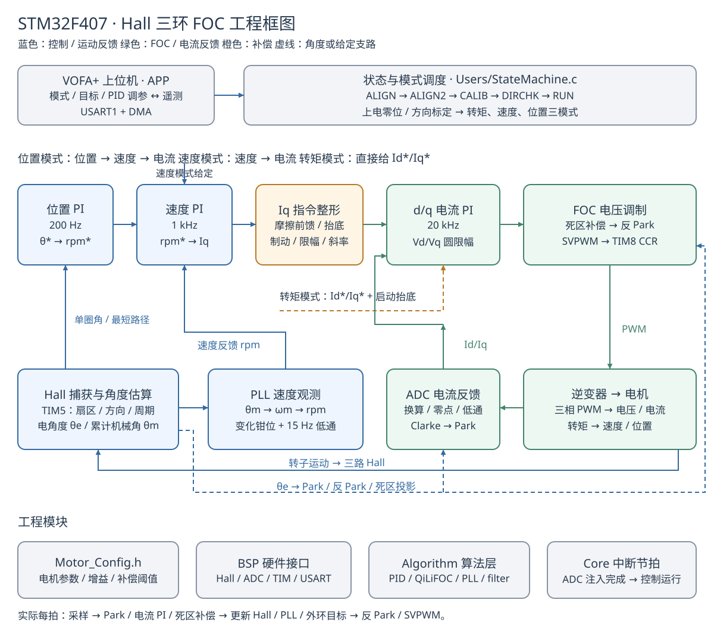
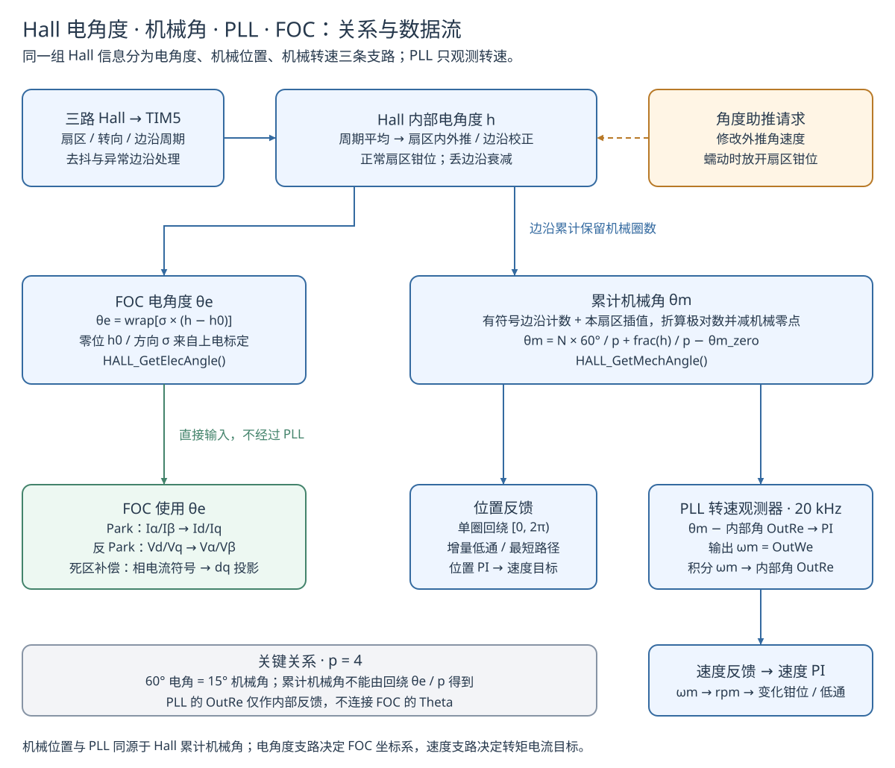

# STM32-FOC-HALL：Hall-Sensor-Based Three-Loop PID FOC Motor Controller

## 基于霍尔传感器的三环 PID 控制系统

> 基于 STM32F407 的
> **20kHz 电流环 / 1kHz 速度环 / 200Hz 位置环**
> 三轴串级 FOC 实现，支持
> **转矩 / 速度 / 位置三模式**
> 在线切换。
> 仅用
> **三路霍尔传感器**
> 完成转矩模式电流环跟踪偏差 < 0.005A，速度模式 5–3600 rpm 全区间速度闭环（±1.5%），实测稳定区间 100-3000rpm，速度过低会较明显抖动，位置模式正向到位精度 < 1.5°。
> 内置
> **18 项补偿机制**
> （摩擦前馈 / 死区补偿 / 角度助推 / PLL 观测器 / 抗积分饱和等）。
> 使用自定义的 QiLi FOC 算法库（包括传统 SVPWM 以及零序注入法）。
> 支持 VOFA+ 在线调参与实时遥测。

**详细原理推导可参考飞书文档：**
***https://jcnraaa979g5.feishu.cn/wiki/LYqFwecP8ie383kMJWmc8ymVnXc?from=from_copylink***


---

## 系统架构总览

### 完整工程框图



### Hall 电角度、机械角、PLL 与 FOC 的关系



---

## 一、项目亮点

### 1.1 核心亮点总览


| 序号 | 亮点                | 做了什么                                                            | 解决了什么问题                                                          | 实测效果                                 |
| -- | ----------------- | --------------------------------------------------------------- | ---------------------------------------------------------------- | ------------------------------------ |
| 1  | **仅用霍尔实现低速闭环**    | 角度助推 (I/F 蠕动) + PLL 转速观测器 + 丢边沿衰减处理，三路配合让低速估算角持续推进              | 霍尔 15° 分辨率在低速下严重量化，传统方案丢边沿后估算角冻结→电流矢量静止→转子被吸住→永久锁死               | 50rpm 稳定运行（修复前完全锁死 0rpm）             |
| 2  | **摩擦前馈状态机**       | 四状态前馈 (REST→MOVING→BRAKE)，静摩擦 0.75A 破障→释放 0.35A 过渡→动摩擦 0.15A 维持 | 静摩擦门槛 (0.15-0.4A) 导致启动困难、低速振荡；传统 PI 要么力矩不足粘住，要么积分饱和突跳过冲          | 50rpm 稳态 Iq 从 0.79A 降至 0.19A，无过冲振荡   |
| 3  | **死区电压补偿**        | 按三相电流符号投影到 dq 轴叠加 0.171V 补偿，零电流区线性过渡                            | 逆变器 357ns 死区造成 0.171V 电压损失，而维持 0.3A 只需 0.125V，不补偿小电流指令本身就是 "糊" 的 | 0.19A 小电流下 Iq 跟踪偏差 < 0.003A          |
| 4  | **零极点对消电流环整定**    | 用电机 R/L 直接计算 Kp=L・ωc・2π, Ki=R・ωc・2π，带宽 300Hz                    | 手动整定 PI 参数困难，相位裕度难以保证                                            | 电流环跟踪偏差 < 0.005A                     |
| 5  | **PLL 转速观测器**     | 二阶 PLL 跟踪连续机械角 (霍尔边沿 + 估算内插)，输出平滑转速 + 15Hz 低通                   | 霍尔单边沿 T 法测速有 60° 量化台阶 + 10ms 延迟，速度环对台阶过激响应导致 Iq 猛冲→自激振荡          | 反馈与真值一致到 0.4–2.4%，无量化噪声              |
| 6  | **上电自标定流程**       | 两次对齐 (0°/180°)→零位细分标定 (缓慢拖动跨边沿)→转矩方向自检 (Iq=0.25A 探极性)           | 霍尔零位不确定 (±30°)、方向二义性导致上电飞车                                       | 零位误差从 ±30° 压到几度，上电无飞车                |
| 7  | **抗积分饱和 (非对称钳制)** | 正向低速钳制 (0.15+0.0008× 目标转速)、负向 0.50A、Iq 斜率 100A/s 三重限制           | 小目标时积分无上限瞬间给满 2A，导致过冲 - 刹回振荡                                     | 阶跃响应无明显超调                            |
| 8  | **VOFA + 在线调参遥测** | 自定义 JustFloat 二进制协议 + 文本命令解析，DMA 非阻塞收发                          | 每次调参都要重新烧录，调试效率低                                                 | 实时修改 id/iq/rpm/pos/PID 增益 / 模式切换，免烧录 |

### 1.2 调试方法论


* **取证级调试**：同一串口流内同时解析固件转速反馈和固件输出电角度，用净转数法独立验证反馈标度，定位了 "反馈链 5× 增益误差" 的误判（实际根因是低速锁死 bug，角度助推被一行`return 0`关掉）

* **二进制帧相位锁定**：自定义 JustFloat 协议解析器，通过连续帧尾匹配实现相位锁定，支持丢帧重同步

* **安全采集脚本**：Python 脚本实时监控转速 / 电流，超过阈值自动发停机命令，硬件调试零风险


***

## 二、关键指标

<div align="center">


| 指标     | 数值                   | 说明                                      |
| ------ | -------------------- | --------------------------------------- |
| 主控 MCU | STM32F407VGT6        | 168MHz Cortex-M4F, 1MB Flash, 192KB RAM |
| 控制频率   | 20kHz / 1kHz / 200Hz | 电流环 / 速度环 / 位置环                         |
| 位置传感器  | 三路霍尔（4 极对电机）         | 无编码器，24 边沿 / 机械圈，15° 机械角分辨率             |
| 速度闭环范围 | 5 – 3600 rpm         | 实测可控区间                                  |
| 速度稳态精度 | ±1.5%（200–3000rpm）   | 达成率 98.6–102.4%                         |
| 电流环带宽  | 300 Hz               | 零极点对消法整定                                |
| 补偿机制   | 18 项                 | 电流环 4 项 + 速度环 9 项 + 位置环 5 项             |
| 母线电压   | 24V DC               | 最大不失真相电压 = 24/√3 = 13.86V               |
| 通信协议   | VOFA+ JustFloat      | 921600bps，DMA 非阻塞                       |


</div>

***

## 三、硬件平台

本系统硬件使用 **硬石科技** YS-F4Pro 开发板、驱动板以及直流无刷（BLDC）电机。


<div align="center">


</div>

<div align="center">


</div>

BLDC 电机参数如图所示：


<div align="center">


</div>

硬件原理图见上传文件夹，此处不做展示。

### 3.1 硬件清单

<div align="center">


| 部件      | 型号 / 参数                 | 说明                                      |
| ------- | ----------------------- | --------------------------------------- |
| 主控 MCU  | STM32F407VGT6           | 168MHz Cortex-M4F, 1MB Flash, 192KB RAM |
| 电机      | 硬石科技配套 BLDC 电机          | 4 极对三相永磁同步电机 / BLDC                     |
| 位置反馈    | 三路霍尔传感器                 | 内置电机，24 边沿 / 机械圈，15° 机械角分辨率             |
| 功率驱动    | 硬石 YS-F4Pro 驱动板         | 三相逆变器，死区时间 357ns                        |
| 电流采样    | 三相分流电阻 + 运放             | Rs=0.02Ω, Gain=4.023, 12 位 ADC          |
| 母线电压    | 24V DC                  | 最大不失真相电压 = 13.86V                       |
| PWM 定时器 | TIM8 中心对齐模式             | ARR=4199, 20kHz PWM, 互补输出 + 死区          |
| 电流采样触发  | TIM8\_CC4 上升沿触发 ADC 注入组 | 与 PWM 中心对齐，采样时刻在电流中点                    |
| 霍尔捕获    | TIM5 输入捕获               | 200kHz 时基 (5µs/tick), 16bit             |
| 通信      | USART1 + DMA            | 921600bps, VOFA+ JustFloat 协议           |

</div>

### 3.2 引脚连接表

<div align="center">

| MCU 引脚     | 功能               | 连接           |
| ---------- | ---------------- | ------------ |
| PI5 / PH13 | TIM8\_CH1 / CH1N | U 相上桥 / 下桥驱动 |
| PI6 / PH14 | TIM8\_CH2 / CH2N | V 相上桥 / 下桥驱动 |
| PI7 / PH15 | TIM8\_CH3 / CH3N | W 相上桥 / 下桥驱动 |
| PA6        | ADC1\_IN6        | U 相电流采样      |
| PB0        | ADC1\_IN8        | V 相电流采样      |
| PB1        | ADC1\_IN9        | W 相电流采样      |
| PH10       | TIM5\_CH1        | 霍尔 A 相       |
| PH11       | TIM5\_CH2        | 霍尔 B 相       |
| PH12       | TIM5\_CH3        | 霍尔 C 相       |
| PB6 / PB7  | USART1\_TX / RX  | VOFA + 上位机通信 |

</div>

***

## 四、软件架构

### 4.1 三环串级控制架构


```
位置指令(°) → [位置环 200Hz] → 速度指令(rpm) → [速度环 1kHz] → Iq指令(A)
                                                                          ↓
三相电流 ← [SVPWM] ← [死区补偿] ← [电流环 20kHz] ← Clarke/Park ← ADC采样
                ↑                                              ↑
           TIM8 20kHz                                    电角度观测
          (PWM+ADC触发)                              (霍尔+PLL+助推)
```


#### 4.1.1 文件架构实现逻辑（20kHz 中断完整执行流）

每拍 50µs 的 ADC 注入组中断（`stm32f4xx_it.c`）是整个系统的心跳，按以下顺序执行：


```
① ADC 采样三相电流 → 一阶低通滤波（Iu/Iv/Iw_filter）
② HALL_GetElecAngle() → 更新电角度估算（含角度助推 / 丢边沿衰减 / 扇区钳位）
③ Clarke 变换（三相→αβ）→ Park 变换（αβ→dq，使用电角度 Theta）
④ 电流环 PI（零极点对消法整定）→ 死区补偿（用 Theta 投影到 dq 轴）
⑤ 反 Park 变换（dq→αβ，使用电角度 Theta）→ SVPWM → 写入 CCR 寄存器
⑥ ── 每 20 拍（1kHz）执行速度环 ──
   PLL_Loop(机械角) → 平滑转速 → 速度环 PI → 摩擦前馈状态机 → Iq 指令
⑦ ── 每 100 拍（200Hz）执行位置环 ──
   位置误差（单圈最短路径）→ 位置环 PI → 速度指令 → 位置专用助推
⑧ VOFA 遥测组帧（JustFloat 协议）→ DMA 非阻塞发送
```

各模块职责划分：

<div align="center">


| 模块          | 文件               | 核心职责                                                         |
| ----------- | ---------------- | ------------------------------------------------------------ |
| **BSP 编码器** | `bsp_encoder.c`  | 霍尔边沿解码 / 去抖 / 电角度估算 / 零位标定 / 方向自检 / 机械角 / 测速融合               |
| **FOC 算法库** | `QiLiFOC.c`      | Clarke / Park / 反 Park / SVPWM（七段式 + 零序注入双方案）/sin-cos 按值缓存优化 |
| **PID 控制器** | `PID.c`          | 三环 PI / 摩擦前馈四状态机 / 非对称抗积分饱和 / Iq 斜率限幅 / 低速禁反向制动              |
| **PLL 观测器** | `PLL.c`          | 二阶锁相环跟踪连续机械角，输出平滑无台阶的机械角速度（转速反馈）                             |
| **主状态机**    | `StateMachine.c` | 上电标定流程 / 三模式分派 / 角度助推判断 / 死区补偿 / 观测器更新 / 模式切换                |
| **VOFA 通信** | `VOFA.c`         | JustFloat 二进制帧组帧 / 文本命令解析 / 在线调参 / DMA 非阻塞收发                 |
| **参数配置**    | `Motor_Config.h` | 全部 18 项补偿参数 + 三环 PID 增益 + 电机物理参数 + 霍尔参数集中管理                  |

</div>

#### 4.1.2 角度之间的关系

本项目存在**两条独立的角度链**，不要混淆：


```
【电角度链 —— 给 FOC 用，不经过 PLL】

霍尔边沿信号
    ↓ 边沿触发 + 扇区内连续外推 + 60°钳位保护
s_hall_ang（原始估算电角度，范围 [0,2π)）
    ↓ 减零位偏移 s_zero_ofs，乘方向符号 s_hall_dir
FOCParm.Theta（FOC 最终用电角度）
    ↓ 用于 Park / 反Park / 死区补偿
    ↓ ÷ HALL_POLE_PAIR(4)
s_mech_angle_out（机械角，连续多圈，标定结束为 0）
    ↓
位置环反馈 + PLL 观测器输入
```


```
【转速链 —— 给速度环用，PLL 只在这里】

s_mech_angle_out（连续机械角）
    ↓ 输入 PLL_Loop()
PLL 内部积分器重建平滑角度 OutRe
    ↓ 跟踪误差驱动 PI
PLL 输出 OutWe（平滑机械角速度 rad/s）
    ↓ 转 rpm + 每帧 ±300rpm 钳位 + 15Hz 低通
speed.f_speed_fb（速度环 PI 反馈）
```

各角度变量详解：

<div align="center">


| 角度变量               | 类型          | 范围          | 计算公式 / 来源                             | 用途                       |
| ------------------ | ----------- | ----------- | ------------------------------------- | ------------------------ |
| `s_hall_ang`       | 原始电角度       | \[0,2π)     | 霍尔边沿 + 外推，钳位在当前扇区 \[start, start+60°] | 内部中间量                    |
| `s_zero_ofs`       | 零位偏移        | \[0,2π)     | 上电细分标定（几度精度）+ 方向自检（极性反则 +π）           | 零点对齐                     |
| `s_hall_dir`       | 方向符号        | ±1          | 方向自检（给小 + Iq 看转子往哪动）                  | 霍尔接线方向修正                 |
| `FOCParm.Theta`    | **FOC 电角度** | **\[0,2π)** | `dir × (hall_ang - zero_ofs)`         | **Park / 反 Park / 死区补偿** |
| `s_mech_angle_out` | 机械角         | 连续多圈        | 边沿计数 ×60°/ 极对数 + 扇区插值 / 极对数 - 标定零位    | 位置环 + PLL 输入             |
| `PLL.OutWe`        | 机械角速度       | rad/s       | PLL 跟踪机械角的 PI 输出                      | 转速反馈（转 rpm 后）            |

</div>

> **关键区分**
> ：FOC 的电角度
> `Theta`
> 直接来自霍尔估算（有 60° 扇区钳位兜底，够用），
> **不经过 PLL**
> ；PLL 只用来从机械角观测出平滑转速，解决霍尔 T 法测速的 60° 量化台阶问题。

#### 4.1.3 补偿机制与 FOC / 角度的链路

18 项补偿中，与角度直接相关的有以下几项，其余（摩擦前馈、抗饱和等）作用在电流 / 速度指令上，不直接修改角度：


```
                    ┌──────────────────────────────┐
                    │     角度助推（I/F 蠕动）        │
                    │  低速时给估算角一个蠕动速度      │
                    │  → 修改 s_angle_spd            │
                    │  → 间接影响 s_hall_ang → Theta │
                    └──────────┬───────────────────┘
                               ↓
霍尔边沿 → s_hall_ang（原始电角度）→ Theta = dir×(ang-zero)
                    ↑                     ↓
          ┌─────────┴──────────┐    ┌────┴────────────────────┐
          │ 丢边沿衰减处理        │    │ 死区电压补偿              │
          │ 丢边沿后角速度线性衰减 │    │ 用 Theta 把三相电流符号   │
          │ 不直接清零→防角度冻结 │    │ 投影到 dq 轴叠加补偿电压  │
          └────────────────────┘    └──────────────────────────┘
                               ↓
                    Theta 用于三处 FOC 计算：
                    ① Park 变换（三相电流→dq）
                    ② 反 Park 变换（dq 电压→αβ）
                    ③ 死区补偿（相电流符号→dq 投影）
                               ↓
                    Theta ÷ 极对数(4) = 机械角
                               ↓
                    ┌──────────┴───────────┐
                    │ PLL 转速观测器         │  位置环反馈
                    │ 输入：连续机械角       │  输入：单圈归一化机械角
                    │ 输出：平滑机械角速度    │  输出：位置误差
                    └──────────────────────┘
```

<div align="center">


| 补偿项                | 与角度的关系                                            | 作用环节                         |
| ------------------ | ------------------------------------------------- | ---------------------------- |
| **死区电压补偿**         | 直接使用 `Theta`，把三相电流符号按 Park 变换投影到 dq 轴             | 电流环 PI 之后、SVPWM 之前           |
| **角度助推（I/F 蠕动）**   | 修改估算角速度 `s_angle_spd`，间接影响 `s_hall_ang` → `Theta` | 速度模式低速段（<25rpm 进入，>45rpm 退出） |
| **丢边沿衰减处理**        | 丢边沿后角速度按 60rad/s² 线性衰减，不直接清零，防角度冻结                | 霍尔模块内部，所有模式通用                |
| **位置专用助推**         | 位置模式独立的蠕动速度（3rad/s），独立通道不共用速度模式助推                 | 位置模式堵转检测时                    |
| **PLL 转速观测器**      | 输入是机械角（从电角度 ÷ 极对数得到），输出平滑转速                       | 速度环反馈，1kHz 速度环每拍调用           |
| 摩擦前馈 / 抗饱和 / 转矩抬底等 | 不直接修改角度，作用在 Iq 指令或速度环 PI 输出上                      | 速度环 / 位置环指令链                 |

</div>

### 4.2 控制节拍

<div align="center">


| 控制环     | 频率     | 实现方式                          | 周期    |
| ------- | ------ | ----------------------------- | ----- |
| 电流环     | 20 kHz | ADC 注入组 JEOC 中断（TIM8\_CC4 触发） | 50µs  |
| 速度环     | 1 kHz  | 电流环内分频（`SPEED_LOOP_DIV=20`）   | 1ms   |
| 位置环     | 200 Hz | 电流环内分频（`POS_LOOP_DIV=100`）    | 5ms   |
| VOFA 遥测 | 可变     | 状态机内调用，DMA 非阻塞发送              | 取决于帧长 |

</div>

### 4.3 上电状态机


```
ALIGN(0°定位, 1s, Id=0.5A)
  → ALIGN2(180°定位, 1s, Id=0.5A)
    → CALIB(零位细分标定, 缓慢拖动转子跨霍尔边沿)
      → DIRCHK(转矩方向自检, Iq=0.25A探测极性, 防π二义性飞车)
        → RUN(三模式可在线切换: m0转矩 / m1速度 / m2位置)
```

### 4.4 目录结构


```
STM32-FOC-HALL/
├── Algorithm/              # 控制算法核心
│   ├── Inc/
│   │   ├── QiLiFOC.h      # FOC变换(Clarke/Park/反Park/SVPWM)
│   │   ├── PID.h           # 三环PID + 摩擦前馈状态机 + 抗饱和
│   │   ├── PLL.h           # 二阶锁相环转速观测器
│   │   ├── VF.h            # V/F开环强拖（本次FOC控制中并未使用）
│   │   └── filter.h        # 滤波器算法库
│   └── Src/
│       ├── QiLiFOC.c
│       ├── PID.c           # ⭐ 摩擦前馈状态机 + 非对称抗积分饱和
│       ├── PLL.c           # ⭐ PLL转速观测器
│       ├── VF.c
│       └── filter.c
├── APP/
│   ├── Inc/VOFA.h          # VOFA+ JustFloat协议定义
│   └── Src/VOFA.c          # ⭐ 遥测组帧 + 文本命令解析(在线调参)
├── BSP/                    # 板级支持包
│   ├── Inc/
│   │   ├── bsp_adc.h       # 三相电流采样 + 零点校准
│   │   ├── bsp_encoder.h   # ⭐ 霍尔解码 + 边沿测速 + 角度估算 + 丢边沿处理
│   │   ├── bsp_tim.h       # PWM生成
│   │   └── bsp_usart.h     # 串口DMA
│   └── Src/
│       ├── bsp_adc.c
│       ├── bsp_encoder.c   # ⭐ 霍尔边沿计数 + 去抖 + 合并过渡补计数
│       ├── bsp_tim.c
│       └── bsp_usart.c
├── Users/                  # 用户层
│   ├── Inc/
│   │   ├── Motor_Config.h  # ⭐ 全部可调参数集中管理（含18项补偿参数）
│   │   └── StateMachine.h  # 状态机定义
│   └── Src/
│       └── StateMachine.c  # ⭐ 主状态机 + 角度助推 + 死区补偿 + 上电标定
├── Core/                   # STM32CubeMX生成的初始化代码
│   ├── Inc/
│   │   ├── main.h
│   │   ├── adc.h / dma.h / gpio.h / tim.h / usart.h
│   │   ├── stm32f4xx_hal_conf.h
│   │   └── stm32f4xx_it.h
│   └── Src/
│       ├── main.c          # 入口：外设初始化 + 主循环
│       ├── adc.c           # ADC1注入组配置（三相电流采样）
│       ├── tim.c           # TIM8 PWM + TIM5霍尔捕获
│       ├── usart.c         # USART1 + DMA
│       ├── dma.c / gpio.c
│       ├── stm32f4xx_hal_msp.c
│       └── stm32f4xx_it.c # 中断服务函数
├── Drivers/                # HAL库 + CMSIS（STM32CubeMX自动生成）
│   ├── STM32F4xx_HAL_Driver/
│   └── CMSIS/
├── MDK-ARM/                # Keil MDK工程文件
│   ├── Base_Project.uvprojx   # Keil工程文件
│   ├── Base_Project.uvoptx    # 工程选项
│   └── startup_stm32f407xx.s  # 启动文件
├── Python/                 # ⭐ 调试工具集（Python）
│   ├── foc_capture.py            # 三模式数据采集（带安全保护 + 二进制帧相位锁定）
│   ├── foc_forensic_verify.py    # 取证级调试：固件转速反馈标度独立验证
│   └── foc_analysis_report.py    # 数据分析 + 可视化图表生成
├── _data/                  # 实测数据归档（CSV）
│   └── three_mode/         # 三模式采集数据
├── _analysis/              # 分析报告 + 可视化图表
│   ├── 三模式实测分析报告.md
│   └── charts/             # PNG图表
└── docs/                   # 参考文档（可选）
```


***

## 五、核心补偿机制详解

> 本项目共实现
> **18 项补偿机制**
> ，分布在电流环 (4 项)、速度环 (9 项)、位置环 (5 项)。
> 每一项均按「做了什么 → 解决了什么问题 → 参数 / 代码位置 → 实测效果」展开。

### 5.1 电流环补偿（4 项）

#### 5.1.1 死区电压补偿


* **做了什么**：在 Park 变换之后、SVPWM 之前，按三相电流的符号把死区电压损失投影到 dq 轴，叠加到 Vd/Vq 输出上；当 | i|<0.05A 时线性过渡，避免零电流附近的正反馈抖动。

* **解决了什么问题**：逆变器上下管死区时间 Tdt=357ns，造成每相平均电压损失 ≈ (Tdt/Ts)・Udc = (357ns/50µs)×24V ≈ 0.171V。而静止维持 0.3A 只需 I・R=0.125V—— 不补偿的话，低 Iq 指令本身就是 "糊" 的，表现为低速力矩不足和电流零点畸变。

* **参数**：`DEAD_TIME_V=0.171V`，`DEAD_IZERO_A=0.05A`，`DEADTIME_COMP_SIGN=1.0`

* **代码位置**：`Deadtime_Compensate()` in `Users/Src/StateMachine.c`

* **实测效果**：0.19A 小电流下 Iq 跟踪偏差 < 0.003A，低速力矩充足。

#### 5.1.2 电流采样滤波整定


* **做了什么**：将三级串联一阶低通滤波器的系数从 0.2 改为 0.4。

* **解决了什么问题**：原系数 0.2 对应极点≈710Hz，三级串联在 300Hz 电流环带宽上吃掉约 69° 相位，相位裕度只剩十几度，容易引发电流环振荡。改为 0.4 后极点≈1.6kHz，相位损失减半。

* **参数**：`CURR_FILTER_ALPHA=0.40`

* **代码位置**：`Users/Inc/Motor_Config.h`，加载点在`Users/Src/StateMachine.c`初始化段

#### 5.1.3 零极点对消法电流环整定


* **做了什么**：不用手调，直接用电机的实际相电阻 R 和相电感 L 计算 PI 参数：Kp = L・ωc・2π，Ki = R・ωc・2π，电流环带宽设为 300Hz。

* **解决了什么问题**：手动整定 PI 参数困难，且难以保证相位裕度；用电机物理参数直接定标，一次到位。

* **参数**：MOTOR\_R=0.415Ω，MOTOR\_L=1.24mH → Kp=2.34，Ki=782.3

* **代码位置**：`Users/Inc/Motor_Config.h`

* **实测效果**：电流环跟踪偏差 < 0.005A。

#### 5.1.4 输出限幅 / 抗积分饱和


* **做了什么**：电流环 PI 输出限幅在 SVPWM 最大不失真电压 Udc/√3=13.856V，积分同步限幅防止电压饱和后继续累积。

* **解决了什么问题**：电压饱和后积分继续累积，退饱和时产生电流冲击。

* **参数**：`CURRENT_OUT_MAX = Udc/√3 = 13.856V`

* **代码位置**：`Algorithm/Src/PID.c` 的 `PI_Current_Loop()`


***

### 5.2 速度环补偿（9 项）—— 本项目最核心

#### 5.2.1 ⭐ 摩擦前馈状态机（最亮点）


* **做了什么**：实现四状态前馈状态机：


  * `REST`（静止）：目标速度非零时立即给`START_A=0.50A`破障，150ms 内爬升到`STATIC_A=0.75A`

  * `MOVING`（转动）：前馈降至`KINETIC_A=0.15A`维持转动

  * 刚脱开静摩擦时保留`RELEASE_A=0.35A`，80ms 平滑降至动摩擦电流，防止转矩突降导致再次停转

  * `BRAKE`（超速）：关闭补偿，交给自然摩擦减速

* **解决了什么问题**：静摩擦门槛约 0.15–0.40A，开环实测 0.10–0.16A 全部是 "粘住→突跳" 的粘滑状态。传统 PI 在低速时要么力矩不足（粘住不动），要么积分饱和（突跳过冲→刹回→振荡）。四状态前馈在 PI 出力之前就把静摩擦 "填平"，PI 只负责动态调节。

* **参数**：`SPEED_FRICTION_STATIC_A=0.75`，`KINETIC_A=0.15`，`RELEASE_A=0.35`，`START_A=0.50`

* **代码位置**：`PID_FrictionFeedforward()` in `Algorithm/Src/PID.c`

* **实测效果**：50rpm 稳态 Iq 从修复前的 0.79A（低速钳制用满）降至 0.19A，无过冲振荡。

#### 5.2.2 ⭐ 角度助推（I/F 蠕动）—— 解决低速锁死


* **做了什么**：当命令了 Iq 电流且转速低于 25rpm 时，让电角度估算器按 10rad/s（≈24rpm 机械）的 "蠕动速度" 继续旋转（开环 I/F 硬拖），转子跟着转过 15° 机械角就产生新的霍尔边沿，随即交回霍尔闭环；转速高于 45rpm 时退出助推（迟滞防止边界振荡）。

* **解决了什么问题**：霍尔在零速 / 极低速下给不出转子在 60° 扇区内的细分位置。丢边沿后若估算角停止推进，电流矢量就静止在定子上，转子永磁 d 轴被吸到 Δ=0，转矩 = Kt・Iq・cos (Δ)→0，转子不动又永远没有新边沿→**永久自锁**。这是本项目调试中最隐蔽的 bug—— 代码里一行`return 0`把速度模式的助推关掉了，导致 50rpm 完全不转。

* **参数**：`ANGLE_ASSIST_W_CREEP=10.0rad/s`，迟滞`RPM_ENTER=25`/`RPM_EXIT=45`

* **代码位置**：`AngleAssist_Creep()` in `Users/Src/StateMachine.c`

* **实测效果**：50rpm 从完全锁死 (0rpm)→49–50rpm 稳定运行；100rpm 从反复停转→97–101rpm。

#### 5.2.3 丢边沿衰减处理


* **做了什么**：丢边沿后分两支处理：有助推请求时按 ±W\_CREEP 推进估算角；无请求时按 60rad/s² 线性衰减到 0（不直接清零），且助推期故意不夹 60° 扇区，让估算角开环越过边界产生新边沿。

* **解决了什么问题**：旧代码丢边沿后直接清零估算角速度→角度冻结→自锁。线性衰减保证角度平滑过渡，不会突然冻死。

* **参数**：`HALL_LOST_DECAY_RS=60.0rad/s²`

* **代码位置**：`BSP/Src/bsp_encoder.c`

#### 5.2.4 转矩抬底


* **做了什么**：堵转状态下且目标 | iq|\<FLOOR 时，实际输出电流抬到 0.50A（大于齿槽 / 静摩擦临界值约 0.40A），转子启动 (>30rpm) 后回到用户目标值。

* **解决了什么问题**：小目标下速度环 PI 输出的电流不足以克服静摩擦起转，转子一直粘在原地。

* **参数**：`CURR_BOOST_FLOOR_A=0.50`，迟滞`RPM_IN=10`/`RPM_OUT=30`

* **代码位置**：`Users/Src/StateMachine.c`

#### 5.2.5 ⭐ PLL 转速观测器


* **做了什么**：用二阶 PLL 跟踪连续机械角（霍尔边沿 + 估算内插），输出连续平滑的机械角速度，输出后再加 15Hz 低通进一步衰减换相台阶尖峰。

* **解决了什么问题**：霍尔单边沿 T 法测速有 60° 量化台阶 + 10ms 窗口延迟，速度环对台阶过激响应导致 Iq 猛冲→力矩冲击→自激振荡。PLL 输出无采样保持台阶，延迟远小于窗口测速。

* **参数**：`kp_theta=300`，`ki_theta=20000`，`SPEED_PLL_LP_HZ=15Hz`

* **代码位置**：`PLL_Loop()` in `Algorithm/Src/PLL.c`

* **实测效果**：反馈与真值一致到 0.4–2.4%，无量化噪声。

#### 5.2.6 PLL 输出速率钳位


* **做了什么**：PLL 输出每帧变化量钳位在 ±300rpm（真实物理上限≈170rpm / 帧）。

* **解决了什么问题**：霍尔换相瞬间角度台阶造成转速尖峰，速度环不应对台阶做过激响应。

* **代码位置**：`Users/Src/StateMachine.c`

#### 5.2.7 低速禁反向制动


* **做了什么**：200rpm 以下同向运行时不输出反向制动 Iq，交给自然摩擦减速。

* **解决了什么问题**：低速下反馈抖动会让 PI 发出反向电流，把电机刹停并进入振荡。

* **参数**：`SPEED_NO_BRAKE_RPM=200.0`

* **代码位置**：`Algorithm/Src/PID.c`

#### 5.2.8 抗积分饱和（非对称钳制）


* **做了什么**：三重钳制：


  * 对称上限：`SPEED_IQ_MAX/Ki = 2.0/0.01 = 200`

  * 负向钳制：`SPEED_IQ_NEG_LIM_A/Ki = 0.50/0.01 = 50`（刹车后积分最深 - 0.50A，恢复期仍有正向保持力矩，无转矩真空）

  * 低速正向钳制：`(0.15 + 0.0008×目标转速)/Ki`（仅目标转速≤200rpm，防止小目标时积分瞬间给满）

* **解决了什么问题**：小目标时积分无上限瞬间给满 2A，导致过冲 - 刹回振荡；非对称钳制保证刹车后仍有正向保持力矩。

* **代码位置**：`Algorithm/Src/PID.c`

* **实测效果**：阶跃响应无明显超调。

#### 5.2.9 Iq 指令斜率限幅


* **做了什么**：速度环输出的 Iq 指令变化率限制在 100A/s。

* **解决了什么问题**：指令跳变引起机械冲击和估算角跟不上。

* **参数**：`SPEED_IQ_SLEW_A_S=100A/s`

* **代码位置**：`Algorithm/Src/PID.c`


***

### 5.3 位置环补偿（5 项）

#### 5.3.1 破静摩擦启动补偿


* **做了什么**：位置环指令≥10rpm（对应位置误差≥\~2.9°）且转子静止时，Iq 抬底到 0.65A 破障；转子启动后撤除交回速度环。

* **解决了什么问题**：位置阶跃时速度环输出力矩不足以跨过齿槽，转子停在目标附近不动。

* **参数**：`POS_BOOST_A=0.65`，`POS_BOOST_CMD_RPM=10`，迟滞`RPM_IN=10`/`RPM_OUT=30`

* **代码位置**：`Algorithm/Src/PID.c`

#### 5.3.2 单圈绝对角 + 最短路径误差


* **做了什么**：位置反馈用`fmod`归一化到 \[0,2π) 单圈角，位置误差走最短路径（±180°）。

* **解决了什么问题**：累计机械角可达几万度，直接与目标 \[0,360°) 相减会产生巨大误差→位置环饱和乱推。

* **代码位置**：`Run_PositionMode()` in `Users/Src/StateMachine.c`

#### 5.3.3 位置反馈低通 + 切入重置


* **做了什么**：切入位置模式时将低通滤波器状态和输出 prev 值对齐到当前真值。

* **解决了什么问题**：ST-LINK 烧录复位不清 SRAM，static 变量残留会造成启动猛冲。

* **代码位置**：`Users/Src/StateMachine.c`

#### 5.3.4 位置输出斜率限制


* **做了什么**：位置环输出（速度指令 rpm）每 5ms 最大变化率限制为 2rpm。

* **解决了什么问题**：目标切换时的机械冲击，防止高 KP 饱和猛冲→目标附近 bang-bang 极限环。

* **参数**：`POS_OUT_RATE_RPM=2.0`

* **代码位置**：`Run_PositionMode()` in `Users/Src/StateMachine.c`

#### 5.3.5 位置专用助推


* **做了什么**：位置模式下独立的蠕动速度（3rad/s≈7rpm 机械），由位置误差方向引导单向慢拖。

* **解决了什么问题**：位置模式下同样会丢边沿自锁；注意位置模式不使用速度模式的角度助推（`AngleAssist_Creep()`对位置模式返回 0），有独立通道。

* **参数**：`HALL_CREEP_W_POS=3.0rad/s`

* **代码位置**：`Users/Src/StateMachine.c`


***

## 六、三模式功能说明

### 6.1 模式切换与遥测帧格式

<div align="center">


| 模式   | 命令   | 通道数  | 帧长  | 输入指令                             |
| ---- | ---- | ---- | --- | -------------------------------- |
| 转矩模式 | `m0` | 6ch  | 28B | `iq=X.X` (A), `id=X.X` (A)       |
| 速度模式 | `m1` | 18ch | 76B | `rpm=XXX` (rpm)                  |
| 位置模式 | `m2` | 8ch  | 36B | `pos=XXX` (°), `posr=X.XX` (rad) |

</div>

### 6.2 在线调参命令

<div align="center">


| 命令                      | 功能        | 示例         |
| ----------------------- | --------- | ---------- |
| `ckp=X.XX` / `cki=X.XX` | 电流环 PI 增益 | `ckp=2.34` |
| `skp=X.XX` / `ski=X.XX` | 速度环 PI 增益 | `ski=0.01` |
| `pkp=X.XX` / `pki=X.XX` | 位置环 PI 增益 | `pkp=200`  |
| `m0` / `m1` / `m2`      | 模式切换      | `m1`       |


</div>

> 所有命令以换行符
> `\n`
> 结尾，大小写不敏感，支持
> `key=value`
> 和
> `keyvalue`
> 两种格式（如
> `iq=0.3`
> 和
> `q0.3`
> 等效）。

### 6.3 遥测通道定义


* **转矩模式 (6ch)**：Id 目标，Id 实际，Iq 目标，Iq 实际，转速反馈 (rpm), 电角度 (°)

* **速度模式 (18ch)**：状态机状态，Id 目标 / 实际，Iq 目标 / 实际，Id/Iq 误差，电流环 Kp/Ki/OutMax, Vd/Vq PI 输出，Vd/Vq 实际电压，电角度 (°), 三相 CCR

* **位置模式 (8ch)**：位置目标 (°), 位置实际 (°), 位置误差 (°), 速度目标 (rpm), 速度实际 (rpm), Iq 目标 (A), Iq 实际 (A), 电角度 (rad)


***

## 七、实测数据

> 数据采集环境：COM12 @ 921600bps，24V 母线，空载，当前固件（含低速助推修复 + 霍尔边沿修复）。
> 真值转速由电角度净转数法折算，不依赖固件反馈通道。

### 7.1 速度模式跟踪精度（核心数据表）

<div align="center">


| 指令 (rpm) | 实测真值 (rpm) | 达成率    | 稳态 Iq (A) | 状态           |
| -------- | ---------- | ------ | --------- | ------------ |
| 50       | 57.6       | 115.2% | 0.193     | ⚠️ 低速粘滑，均值偏高 |
| 100      | 98.6       | 98.6%  | 0.277     | ✅ 精准         |
| 200      | 204.8      | 102.4% | 0.190     | ✅ 精准         |
| 400      | 406.6      | 101.7% | 0.196     | ✅ 精准         |
| 800      | 810.7      | 101.3% | 0.224     | ✅ 精准         |
| 1500     | 1520.2     | 101.3% | 0.270     | ✅ 精准         |
| 2000     | 2029.4     | 101.5% | 0.298     | ✅ 精准         |
| 2500     | 2536.9     | 101.5% | 0.324     | ✅ 精准         |
| 3000     | 3044.8     | 101.5% | 0.334     | ✅ 精准         |

</div>

> **结论**
> ：200–3000rpm 全区间稳态误差 < 2.5%；3000rpm 仅需 0.33A（占电流上限 2A 的 16.5%，电流裕量充足）。50rpm 档均值偏高系机械粘滑本性（瞬时转速在 0–100rpm 间波动），非控制缺陷。

### 7.2 转矩模式电流 - 转速特性

<div align="center">


| Iq 指令 (A) | Iq 实测 (A) | 电流偏差 (A) | 实测转速 (rpm) | 状态                |
| --------- | --------- | -------- | ---------- | ----------------- |
| 0.10      | 0.297     | +0.197   | 9.8        | ⚠️ 近静摩擦门槛（转矩抬底生效） |
| 0.20      | 0.198     | -0.002   | 491.6      | ✅ 正常跟踪            |
| 0.30      | 0.301     | +0.001   | 2008.0     | ✅ 正常跟踪            |
| 0.50      | 0.443     | -0.057   | 3285.9     | ⚠️ 电压饱和区          |

</div>

> **结论**
> ：0.2/0.3A 档电流环跟踪偏差 < 0.002A；静摩擦门槛≈0.1–0.15A；空载转速平台≈3300rpm（受 24V 母线电压限制）。

### 7.3 位置模式阶跃响应


<div align="center">

| 目标 (°) | 实际 (°) | 误差 (°) | 误差 std (°) | 方向 | 状态    |
| ------ | ------ | ------ | ---------- | -- | ----- |
| 180    | 178.6  | +1.39  | 10.9       | 正向 | ✅ 到位  |
| 270    | 269.5  | +0.56  | 8.6        | 正向 | ✅ 到位  |
| 180    | 206.7  | -26.6  | 5.5        | 回程 | ⚠️ 接近 |
| 90     | 208.6  | -118.6 | 0.0        | 回程 | ❌ 未到位 |

</div>

> **结论**
> ：正向运动到位精度 < 1.5°；回程不足为已知待优化项（位置模式反向摩擦补偿方向逻辑需检查，详见第八节）。位置稳态误差 std 5–11° 受霍尔 15° 机械角分辨率（半个台阶 = 7.5°）支配。

### 7.4 可视化图表


* 转矩模式电流 - 转速特性：


* 速度模式指令 vs 实测 + Iq 特性：


* 位置模式阶跃响应：


* 三模式综合评分雷达图：


***

## 八、已知不足与改进方向

<div align="center">


| 序号 | 不足                  | 影响                                      | 改进方向                                         |
| -- | ------------------- | --------------------------------------- | -------------------------------------------- |
| 1  | **位置模式回程不到位**       | 反向运动最大误差 - 118.6°，Iq 已达 - 1.05A 仍无法反向转动 | 检查位置模式反向摩擦补偿的方向逻辑；适当提高`POS_RPM_MAX`；增加回程专用补偿 |
| 2  | **电流采样固定偏置≈+0.13A** | 小电流指令时 Iq 实测偏高（0 指令时仍报 0.13–0.15A）      | 运行期动态零点校准；开启扇区无效相修正                          |
| 3  | **速度帧缺转速通道**        | 速度模式 18 通道中无直接 rpm 反馈，需从电角度推算           | 在`VOFA.c`速度分支增加`Motor_GetSpeedFB()`通道        |
| 4  | **位置分辨率下限 7.5°**    | 位置稳态误差 std 5–11°，受半个霍尔台阶支配              | 改用编码器 / 磁编码器；或增加观测器插值精度                      |
| 5  | **低速瞬时纹波 ±25%**     | 50rpm 瞬时转速波动大（均值准确）                     | 系机械粘滑本性，可尝试更高分辨率反馈或非线性 PID                   |
| 6  | **转矩模式大电流电压饱和**     | ≥0.5A 时转速进入 3300rpm 平台，Iq 跟踪变差          | 系 24V 母线电压限制，硬件层面无法避免；可弱磁扩速                  |
| 7  | **位置环输出限速 40rpm**   | 大角度阶跃响应时间长                              | 可提高到 60–80rpm（需重新整定速度环参数）                    |


</div>

***

## 九、快速开始

### 9.1 环境要求


* Keil MDK-ARM 5.x（工程文件在`MDK-ARM/`）

* STM32CubeMX 6.x（可选，用于重新配置引脚）

* VOFA+ 上位机（用于调参和波形观察，官网：[https://www.vofa.plus/](https://www.vofa.plus/)）

* Python 3.8+（用于数据采集和分析，需安装依赖）

### 9.2 编译烧录


1. 用 Keil 打开 `MDK-ARM/Base_Project.uvprojx`

2. 编译

3. 用 ST-LINK 烧录

### 9.3 上电运行


1. 上电后电机自动执行：对齐 (0°)→对齐 (180°)→零位标定→方向自检→进入 RUN 状态（约 3–4 秒）

2. 默认进入转矩模式 (`m0`)，Iq=0，电机静止

3. 打开 VOFA+，选择串口，波特率 921600，协议选**JustFloat**

### 9.4 基本操作示例


```
# 切换到速度模式，给定1000rpm
m1
rpm=1000

# 切换到转矩模式，给定0.3A
m0
iq=0.3

# 切换到位置模式，转到180°
m2
pos=180

# 紧急停机（任何模式下都有效）
iq=0
rpm=0
```

### 9.5 数据采集与分析


```
# 安装Python依赖
pip install pyserial matplotlib numpy pandas

# 三模式综合采集（带安全保护，超限自动停机）
python Python/foc_capture.py --mode 0  # 转矩模式
python Python/foc_capture.py --mode 1  # 速度模式
python Python/foc_capture.py --mode 2  # 位置模式

# 生成分析报告和可视化图表
python Python/foc_analysis_report.py
```

> 采集脚本内置安全保护：实时监控转速和电流，超过
> `rpm>4200`
> 或
> `|Iq|>2.5A`
> 立即发送
> `rpm=0`
> /
> `iq=0`
> 并中止采集。


***

## 十、许可证

本项目采用 **MIT License** 开源。

> MIT License 允许任何人自由使用、修改、分发、商用，只需保留版权声明和许可声明。
> 适合个人开源项目，企业也可放心参考使用。


***

## 十一、致谢与参考


* STM32 HAL 库（STMicroelectronics，BSD-3-Clause License）

* VOFA+ 上位机（[https://www.vofa.plus/](https://www.vofa.plus/)）

* [SguanFOC\_Library](https://github.com/Sguan-ZhouQing/SguanFOC_Library) — PLL 转速观测器设计参考


***

## 附录 A：关键参数速查表

<div align="center">


| 参数             | 值                    | 定义位置                        |
| -------------- | -------------------- | --------------------------- |
| 控制频率           | 20kHz / 1kHz / 200Hz | `Motor_Config.h`            |
| 极对数            | 4                    | `HALL_POLE_PAIR`            |
| 母线电压           | 24V                  | `_Udc`                      |
| 相电阻            | 0.415Ω               | `MOTOR_R`                   |
| 相电感            | 1.24mH               | `MOTOR_L`                   |
| 电流环带宽          | 300Hz                | `CURRENT_BW_HZ`             |
| 电流环 Kp/Ki      | 2.34 / 782.3         | `CURRENT_KP` / `CURRENT_KI` |
| 速度环 Kp/Ki      | 0.002 / 0.010        | `SPEED_KP` / `SPEED_KI`     |
| 位置环 Kp/Ki      | 200 / 10             | `POS_KP` / `POS_KI`         |
| 电流限幅           | ±2A                  | `TORQUE_CURRENT_MAX`        |
| 速度指令限幅         | 3600rpm              | `SPEED_FB_RPM_MAX`          |
| 位置输出限幅         | 40rpm                | `POS_RPM_MAX`               |
| 死区补偿电压         | 0.171V               | `DEAD_TIME_V`               |
| 摩擦静 / 动 / 释放电流 | 0.75 / 0.15 / 0.35A  | `SPEED_FRICTION_*`          |
| 角度助推速度         | 10rad/s ≈ 24rpm      | `ANGLE_ASSIST_W_CREEP`      |
| PLL Kp/Ki      | 300 / 20000          | `kp_theta` / `ki_theta`     |
| 串口波特率          | 921600               | `usart.c`                   |


</div>

***

## 附录 B：VOFA+ JustFloat 协议说明

### 帧结构


```
[float1][float2]...[floatN][0x00][0x00][0x80][0x7F]
```


* 数据段：N 个小端序 float32（N = 通道数）

* 帧尾：固定 4 字节 `00 00 80 7F`

* 帧长 = 通道数 × 4 + 4

### 命令格式（文本，以`\n`结尾）

<div align="center">


| 命令                       | 功能               | 示例          |
| ------------------------ | ---------------- | ----------- |
| `m0` / `m1` / `m2`       | 切换转矩 / 速度 / 位置模式 | `m1`        |
| `iq=0.3` 或 `q0.3`        | 设置 Iq 目标 (A)     | `iq=0.5`    |
| `id=0.1` 或 `d0.1`        | 设置 Id 目标 (A)     | `id=0`      |
| `rpm=1000` 或 `s1000`     | 设置速度目标 (rpm)     | `rpm=500`   |
| `pos=180` 或 `p180`       | 设置位置目标 (°)       | `pos=90`    |
| `posr=3.14`              | 设置位置目标 (rad)     | `posr=1.57` |
| `ckp=2.34` / `cki=782`   | 电流环 PI 增益        | `ckp=2.34`  |
| `skp=0.002` / `ski=0.01` | 速度环 PI 增益        | `ski=0.01`  |
| `pkp=200` / `pki=10`     | 位置环 PI 增益        | `pkp=200`   |

</div>
